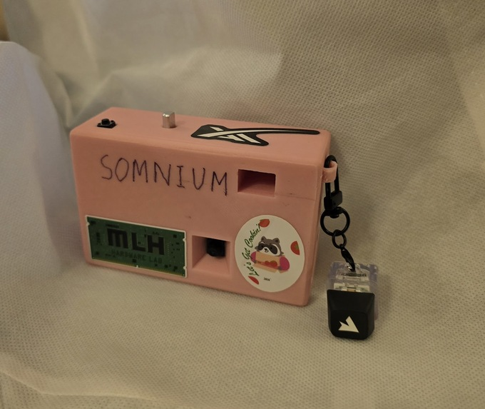
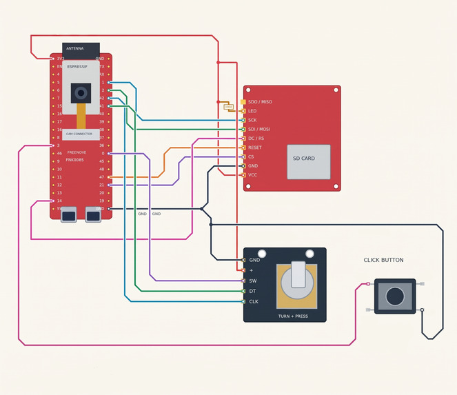

# Somnium



A handheld camera. You pick a look, press the shutter, and the board sends the JPEG to a laptop over the home Wi-Fi, or over USB when the laptop is not connected. The laptop reads the weather, writes an edit for that look, and asks Grok Imagine to repaint the shot. The edited JPEG comes back the same way onto a 320×240 screen. The original and the edit both stay on the SD card.

*Somnium* is Latin for "the dream." The word is also the title of Johannes Kepler's *Somnium* (1634), often called the first science-fiction novel, a dream of a voyage to the Moon and of the Earth seen from there.

Photos from the camera are posted at [somnium.photo](https://somnium.photo). The site was built with Cursor and Grok Bot.

## In the hand

The firmware screens are Boot, Modes, Process, Review, and Storage.

Modes is a carousel: Comic, Watercolor, Anime, Surprise, and Pencil Sketch. The card art is compiled in from `creative/previews`. The shutter takes a photo in the selected mode from any screen. Process is the wait: a flame, a salt shaker, and a whisk, redrawn while the laptop works. Review holds the edit for a few seconds. Click the dial to open Storage. Turning it there steps through saved shots and flips each pair between the raw photo and the edit, labeled `ANIME-raw` and `ANIME-mod`.

A shot is two files:

```
/somnium/anime_3_0_orig.jpg
/somnium/anime_3_1_dream.jpg
```

The next shot number skips filenames already on the card, so a reboot leaves the existing pairs alone. If the SD write fails, the same pair is kept in RAM and still shows up in Storage.

## USB serial

The laptop link is the board's USB serial port: the onboard CH340, UART0, 921600 baud. Power, logs, and both JPEGs use that cable.

The camera opens a cook with a text header, the JPEG, and a trailer. `id` is a random request id. `crc` is the CRC32 of the JPEG bytes (`esp_rom_crc32_le`, the same value as Python `zlib.crc32`).

```
COOK style=anime len=18420 id=a1b2c3d4 crc=1a2b3c4d lat=47.65530 lon=-122.30350
<jpeg bytes>
COOK_END
```

`scripts/usb_bridge.py` reads that frame and POSTs it to `http://127.0.0.1:8080/v1/process`. When the edit comes back, the bridge sends the length and checksum first and waits:

```
DREAM a1b2c3d4 16200 5e6f7081
```

The ESP allocates a buffer and answers `READY DREAM a1b2c3d4`. Only then does the bridge send the JPEG and `DREAM_END`. The camera checks the trailer, the CRC, and the JPEG markers, then replies `ACK DREAM a1b2c3d4`. The bridge reports success after that ACK.

A disconnect abandons the in-flight request. The next connection starts clean. Firmware and the bridge implement the same handshake, so they are updated together.

Two things that made the transfer reliable: the serial receive buffer is 64 KB, because a dream JPEG is tens of kilobytes and the default 256-byte buffer overflowed while the panel was still refreshing. And the UI keeps animating during the wait, then stops once the DREAM header arrives, so SPI drawing and the incoming JPEG are not interleaved.

The same port still takes operator commands: `hello`, `capture`, `cooktest`, `sdlist`, `sdpull`, `sdwipe`, and `TIME <epoch>` to set the clock.

## Wi-Fi

The cook uses the same COOK / DREAM bytes over TCP. The board joins the network in `include/wifi_secrets.h`, listens on port 8090, and advertises `somnium.local`. `scripts/wifi_bridge.py` connects, posts the JPEG to `http://127.0.0.1:8080/v1/process`, and sends the edit back. If that socket drops, the bridge connects again and does not replay the cook that was in flight. A shutter press with no Wi-Fi client still uses the USB serial port, so `./scripts/usb_bridge.sh` keeps working. When a Wi-Fi client is connected, the cook goes there.

Operator commands stay on USB. Stop the USB bridge before `sdpull` or flashing; the Wi-Fi bridge does not hold the serial port.

```sh
cp include/wifi_secrets.example.h include/wifi_secrets.h
# Set SOMNIUM_WIFI_SSID and SOMNIUM_WIFI_PASSWORD. This file stays out of git.

./scripts/flash.sh
./scripts/server.sh        # leave this running
./scripts/wifi_bridge.sh   # leave this running while shooting
```

An empty SSID leaves Wi-Fi off. The serial log prints `WIFI somnium ip=…` and `WIFI mdns somnium.local` once the board is associated. If the laptop cannot resolve `somnium.local`, pass that address:

```sh
./scripts/wifi_bridge.sh --host 192.168.1.20
```

`SOMNIUM_HOST` and `SOMNIUM_PORT` (default `somnium.local` and `8090`) override the same values. Do not run the USB bridge and the Wi-Fi bridge at the same time.

### Direct server

Leave `SOMNIUM_SERVER_HOST` empty (the example file) and the board keeps the `somnium.local` cook above. No process token is sent.

To cook straight at a public host, copy the example and set the host. `SOMNIUM_SERVER_TLS` `1` opens TLS to the configured port. For Fly that port is 443, and the path is `/v1/process`. The certificate check is off (`setInsecure`): the POST is still encrypted, and the board does not carry a CA store. When `SOMNIUM_PROCESS_TOKEN` is non-empty, the POST includes `X-Somnium-Token`. That value has to match the server. Leave the token empty for an open server. The same names in `.env` (`SOMNIUM_SERVER_URL`, `SOMNIUM_PROCESS_TOKEN`) steer `wifi_bridge.py` and `usb_bridge.py` when you are still using a laptop bridge.

```sh
cp include/server_config.example.h include/server_config.h
# host, port 443, SOMNIUM_SERVER_TLS 1, process token. This file stays out of git.
```

A configured host does not fall back to USB after a failed POST, so one shutter press is one edit. The screen says `wifi > server...`.

Set `SOMNIUM_GALLERY_URL` and `SOMNIUM_GALLERY_TOKEN` in that same file only when the camera should upload the shot. The cook then includes `skip_gallery=1`, and the server does not upload it again. Leave both empty to let the server upload when `SOMNIUM_UPLOAD_URL` and `SOMNIUM_UPLOAD_TOKEN` are set. The gallery token is a different secret from the process token.

## Photo processing

The server is a FastAPI app with one endpoint, `POST /v1/process`. The body is multipart: `image`, `style`, `taken_at`, and optional `lat` / `lon`. The response body is the edited JPEG. Headers carry the style, a short prompt preview, and the filenames that were saved.

**Where and when.** Open-Meteo supplies weather, cloud cover, wind, daylight, sunrise, and sunset for the lat/lon on the cook. That coordinate is the venue in `server/settings.json`, and the same pair is compiled into the firmware. Moon phase is computed on the laptop. A short list of bright-sky names is a season and hour heuristic. This step uses no API key. If Open-Meteo fails, a stub context is filled in and the edit still runs.

**Light, not weather as subject.** `mood_artifacts` in `creative/creative.json` turns the weather and the time of day into two short cues: softer shadow edges, a cooler fill, warmer highlights. The prompt writer folds those into one sentence about light on surfaces already in the frame. Moon phase and the other sky notes are saved on the shot and left out of the prompt. Longer mood language made the image model paint the weather in as new scenery.

**The instruction.** Each mode has a draft in `creative.json`. The draft names the medium (ink and halftone, watercolor, cel shading, colored pencil) and tells the model to keep the people, the number of objects, the pose, the crop, and the room. `grok-3-mini` rewrites that draft into one edit, roughly 100 to 160 words. Surprise has no fixed medium. The server picks a treatment, a palette, and a focus from the lists on that mode, skipping the combination it used last time, and the prompt has to follow the pick. A film treatment stays a photograph.

**The edit.** `grok-imagine-image-2.0` takes the photo and the prompt on `/v1/images/edits`. A short constraint is appended: same crop, same setting, no added text. The model returns a larger image. The server scales it back to the camera frame with Lanczos and writes JPEG at quality 85. On this board that frame is 320×240, which is what goes back over USB and onto the card.

Each shot also leaves three files in `server/outputs/`: the original, the dream, and a JSON sidecar with the full prompt and context. The HTTP prompt header is plain ASCII and truncated. A generated prompt with a stray character was rejected by the HTTP stack after the image had already been made, so the header is a preview and the JSON is the record.

The same pipeline runs without the camera:

```sh
./scripts/cook.sh photo.jpg --style watercolor
```

## The board and the screen



Freenove ESP32-S3 WROOM CAM, 16 MB flash, octal PSRAM. An ILI9341 320×240 on SPI at 10 MHz, a rotary encoder, a shutter button, and a microSD card. The enclosure is `cad/Front Panel.stl` and `cad/Back Panel.stl`.

LCD pins are SCK 1, MOSI 2, CS 21, DC 14, RST 47. Encoder CLK 42, DT 41, switch on GPIO 0. Shutter on GPIO 3. GPIO 0 is also BOOT, so the knob has to be released while resetting or flashing. On boot the panel flashes red, green, blue, then black.

The sensor is mounted in portrait. Before the JPEG is encoded, firmware crops a square from the frame, rotates it to landscape 320×240, and mirrors it horizontally. The mirror flag is `Defaults::kCameraMirrorHorizontal` in `lib/Somnium/Config.h`. The sensor is powered down for the USB wait. Leaving it running through the edit was dropping the CH340 off the bus.

The panel decodes JPEGs with TJpg_Decoder, native RGB565, byte swap off. The camera library exports its own `jd_prepare` and `jd_decomp`, with a different struct and pixel format. Linking that decoder in produced corrupt frames. Display code stays on TJpg_Decoder, and a test reads the firmware map to confirm both symbols resolve there.

A full panel is 76,800 pixels. Flushing all of them at 10 MHz was too slow for the carousel, so the canvas keeps the previous frame in PSRAM and sends the runs that changed. If that buffer cannot be allocated, it sends the whole frame. Every screen draws through that canvas, so the saved frame matches what was last shown.

On-screen text is Adafruit GFX, ASCII. Colors, the logo, mode names, thumbnails, and prompt drafts live in `creative/`. `./scripts/sync_creative.sh` regenerates the firmware headers, including the 138×82 mode thumbnails. The Python server reads `creative.json` on startup, so a prompt edit is a server restart. A color, font, logo, or thumbnail edit is a sync, a rebuild, and a flash.

`./scripts/ui_preview.sh` draws the same screens in a window on the laptop.

Code is split like this:

- `lib/Somnium` — camera, USB, SD, buttons, display
- `lib/SomniumUi` — pages, canvas, text, tweens
- `lib/SomniumApp` — the five screens, and the generated mode and theme headers
- `server/` — the FastAPI pipeline
- `scripts/usb_bridge.py` — serial to `/v1/process`
- `scripts/wifi_bridge.py` — the same cook framing over TCP to `/v1/process`
- `include/server_config.h` — optional direct HTTPS cook (host, TLS, process token)

## Run

Nix, the ESP32-S3 on USB, and an xAI key.

```sh
nix develop
cp .env.example .env     # XAI_KEY=...
cp include/wifi_secrets.example.h include/wifi_secrets.h   # SSID and password
cp include/server_config.example.h include/server_config.h # optional; empty host = somnium.local

./scripts/flash.sh
./scripts/server.sh       # leave this running
./scripts/wifi_bridge.sh  # while shooting, over Wi-Fi
```

USB instead of Wi-Fi: leave the Wi-Fi bridge stopped and run `./scripts/usb_bridge.sh`. Stop that USB bridge before flashing or before `./scripts/usb_pull_sd.sh`, which copies `/somnium` into `demos/sd_<timestamp>/`. A Wi-Fi bridge reconnects by itself after a flash. `./scripts/dev.sh` prints the same checklist.

Offline, with no board attached:

```sh
nix develop -c pio run
nix develop -c python -m unittest discover -s tests -p 'test_*.py' -v
```

Wire format: [PIPELINE.md](https://github.com/mm-nair/Somnium/blob/main/PIPELINE.md). Editing modes and prompts: [creative/README.md](https://github.com/mm-nair/Somnium/blob/main/creative/README.md).

## Built with

ESP32-S3, PlatformIO, FastAPI, xAI Grok, Open-Meteo, Nix. Public gallery: [somnium.photo](https://somnium.photo).

## Gallery upload

On the NixOS image server, shots are saved under `server/outputs/`. Uploading
them is optional. Source a mode `600` env file that stays out of git (see
[`server/README.md`](server/README.md)):

```sh
export SOMNIUM_UPLOAD_URL=https://www.somnium.photo/api/upload
export SOMNIUM_UPLOAD_TOKEN=your-token-here
```

`your-token-here` is a placeholder. When both variables are set for the camera
server, it uploads each saved shot and the directory watcher is optional. To
watch `server/outputs` instead, from the repository root:

```sh
nix develop -c python server/scripts/somnium_uploader.py watch server/outputs
nix run .#uploader
```

