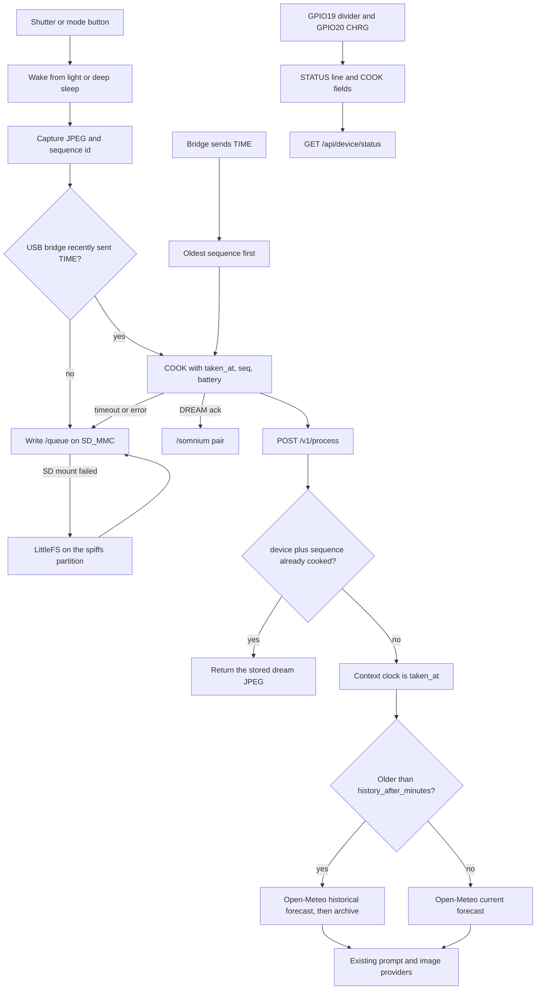

# Power management and the offline shot queue

Somnium can leave the laptop. The ESP32-S3 sleeps between shots, reads a 1S pack through a resistor divider, and keeps JPEGs on the SD card (or on flash) until the USB bridge is back. The server accepts those late uploads under the original capture time and will not cook the same device sequence twice.

This does not add Wi-Fi, BLE, on-camera screens, or a new style engine. The UI layer only gets callbacks.

## Architecture



Hooks the UI can subscribe to, without drawing anything:

- `Power::setListener` — `sample`, `low`, `charge`, `light-sleep`, `deep-sleep`, `wake`
- `ShotQueue::setListener` — `enqueued`, `evicted`, `dropped`, `sync-start`, `sync-fail`, `sync-ack`

The app logs both over the existing serial port. A deep-sleep wake on the shutter starts a capture after the boot screen; a wake on the mode button (the encoder switch) just opens Modes.

## When the camera sleeps

Sleep runs only from the mode screen, after boot grace, and only when a button is not held.

| Timer | Default | What it does |
| --- | --- | --- |
| Boot grace | 15 s | Stay awake so a monitor or bridge can attach |
| Light sleep | 20 s idle | CPU stops. Wake on shutter GPIO3 low, mode GPIO0 low, UART0 RX, or a 5 s slice if deep sleep is also enabled |
| Deep sleep | 3 min idle | CPU and RAM off. Wake on GPIO3 or GPIO0 low, then reboot |
| Link hold | 45 s | Each `TIME` or `hello` from the bridge suppresses sleep |

The bridge sends `TIME` every 30 seconds, so a tethered booth session does not sleep. Unplug the laptop and the same firmware sleeps. `sleep off` / `sleep on` on the serial port overrides the compile-time flags until reboot.

Light sleep is sliced so the deep-sleep deadline is still checked. A button wake resets the idle timer. A timer wake does not, or the camera would never reach deep sleep.

Deep sleep does not return. The next boot prints `POWER wake ...`. Holding the dial during that boot still enters the ROM download mode, because GPIO0 is BOOT.

## Battery divider

GPIO19 is ADC2 channel 8. GPIO20 is a pulled-up input. This build talks through the CH340 on UART0 (`ARDUINO_USB_CDC_ON_BOOT=0`), so those two pins are not the serial link. ADC2 is shared with the Wi-Fi radio: readings are valid only while Wi-Fi is off. This firmware does not start Wi-Fi. A radio brought up by another team will invalidate the gauge until it is moved to an ADC1 pin, and ADC1 is currently the camera bus.

```text
1S Li-ion BAT+ ---- R1 100k ----+---- R2 100k ---- GND
                                |
                             GPIO19

TP4056 CHRG (open drain, low while charging) ---- GPIO20
                                              internal pull-up to 3.3 V
BAT- and TP4056 GND ---- ESP32 GND
```

Do not connect BAT+ to the pin. A full cell is 4.2 V and the pad is 3.3 V. Two equal resistors cut that in half:

- Ratio `(R1+R2)/R2 = 2`
- 4.2 V at the cell is 2.1 V at the ADC, inside the 11 dB range
- Divider current at 4.2 V is about 21 µA

The percent curve is a resting 1S table in `lib/Somnium/BatteryCurve.h` (3.20 V = 0%, 3.70 V = 45%, 4.20 V = 100%), piecewise linear. It is not compensated for load or temperature. Low battery is 15%, with 2 points of hysteresis before the low flag clears.

`STATUS` is printed every 30 s and the same numbers ride on `COOK`:

```text
STATUS dev=esp0000a1b2c3d4e5 bat=71.5 mv=3812 chg=0 low=0 q=2 seq=14
COOK style=anime ... taken_at=2026-10-18T15:04:00-07:00 dev=esp... seq=14 qid=14 bat=71.5 mv=3812 chg=0 q=2 low=0
```

`dev` defaults to the efuse MAC (`esp` plus 16 hex digits). Set `Defaults::kDeviceId` to override it. `bat` / `queue` / `sleep on` / `sleep off` are operator lines on the same port.

A raw ADC count pinned near 0 or full scale is reported as invalid so an unwired GPIO19 does not look like a dead cell. A floating pin that sits in the middle of the range still looks like a battery. Treat the numbers as real only after the divider is soldered.

## Offline queue

Each shutter allocates a monotonic sequence id from NVS (`Preferences` namespace `somnium`, key `nextSeq`) before the cook is attempted. The id is in the COOK header. If the cook fails, the JPEG and a sidecar are stored:

```text
/queue/q00000014.jpg
/queue/q00000014.meta
```

The directory is `/queue`, not `/somnium`, so the gallery scan does not show unsent frames. Metadata is `style`, `taken_at` (device local time with a numeric offset), battery, and length. The clock comes from the bridge `TIME` command, which also sets `TZ` to Pacific.

SD (SD_MMC, already mounted by `Storage`) is preferred. If the card is missing or the write fails, the same files go to LittleFS. `LittleFS.begin` uses the `spiffs` partition from PlatformIO `default_16MB.csv` and formats it on first failure. Nothing else in this repo uses that partition. Formatting it once is expected; do not store other data there.

Bounds, oldest sequence first:

- 24 shots across both media
- 8 MB of JPEG bytes on SD
- 1 MB of JPEG bytes on flash

A second enqueue of the same sequence id is a no-op. Corrupt meta is deleted so one bad file cannot block the rest. After a successful DREAM the queue file is removed and, when the card is mounted, the pair is also copied into `/somnium` like a live shot.

Sync runs on the mode screen once `TIME` or `hello` has been seen. One shot per loop, oldest first, same COOK frame the bridge already understands. Failure backs off 2 s, 4 s, 8 s, … capped at 60 s. A bridge timeout clears the “link up” flag until the next `TIME`, so a dead cable does not spin. A server error keeps the link and retries. Reconnect (link was down, now `TIME`) tries immediately. `TIME` every 30 s does not reset the backoff, or a down server would retry on every clock sync.

The server dedupes by device id plus sequence id, so a cook that landed but whose DREAM never made it back is safe to send again.

## Server

`POST /v1/process` accepts the existing fields plus:

| Form field | Meaning |
| --- | --- |
| `taken_at` | Original capture time, not the upload time |
| `device_id` | Stable camera id. Missing → `unknown` |
| `sequence_id` | Monotonic id. With `device_id`, the idempotency key |
| `queue_id` | Same id from the queue. Used as the sequence when `sequence_id` is absent |
| `battery_pct`, `battery_mv`, `charging`, `queue_depth`, `low_battery` | Telemetry stored for the status hook |

A repeated key returns the previous dream JPEG with `X-Somnium-Idempotent: replay` and does not run the prompt or image providers again. The ledger is a JSON pointer at `outputs/ledger/<device>__<sequence>.json` aimed at the dream file. If that file has been deleted, the shot is cooked again. A failed cook is not recorded, so a 502 can be retried. Battery fields on a retry still update the status store.

Context uses `taken_at`:

- Younger than `history_after_minutes` (default 90): current Open-Meteo forecast, as before
- Older: [historical forecast API](https://historical-forecast-api.open-meteo.com/v1/forecast), then the [archive API](https://archive-api.open-meteo.com/v1/archive). The hourly sample closest to the capture instant supplies temperature, weather code, cloud, wind, and `is_day`. Moon phase was already computed from `taken_at`
- `time_of_day` is the wall clock of that sample (`dawn` 05–08, `morning` 08–12, `afternoon` 12–17, `dusk` 17–20, otherwise `night`). `day_part` stays `day`/`night` from `is_day`, which is what the existing mood pools read
- If both history calls fail, the stub context still labels time from the capture timestamp

`GET /api/device/status` returns the latest report per device (`battery_pct`, `battery_v`, `charging`, `low_battery`, `queue_depth`, `last_sequence_id`). `POST /api/device/status` with a JSON object records a periodic `STATUS` line. The bridge derives that URL from `--url` (`http://127.0.0.1:8080/v1/process` → `http://127.0.0.1:8080/api/device/status`). The file `outputs/device_status.json` survives a server restart. Low battery on the server uses the same 15% cutoff when the camera did not send a flag.

## Config flags

Firmware, `lib/Somnium/Config.h`:

| Flag | Default | Role |
| --- | --- | --- |
| `Pins::kBatteryAdc` | GPIO 19 | Divider midpoint |
| `Pins::kChargeSense` | GPIO 20 | TP4056 CHRG, active low. Negative disables it |
| `Defaults::kDeviceId` | `""` | Empty uses the efuse MAC |
| `kBatteryMonitor` | `true` | Sample the ADC |
| `kDividerRatio` | `2.0` | `(R1+R2)/R2` |
| `kAdcFullScaleVolts` | `3.1` | 11 dB full-scale assumption, not a calibrated Vref |
| `kAdcMax` | `4095` | 12-bit counts |
| `kLowBatteryPct` | `15` | Low-battery event |
| `kBatterySampleMs` | `5000` | ADC period |
| `kStatusPeriodMs` | `30000` | `STATUS` line period |
| `kLightSleepEnabled` | `true` | Light sleep when untethered |
| `kDeepSleepEnabled` | `true` | Deep sleep when untethered |
| `kSleepOnlyWhenUntethered` | `true` | `TIME`/`hello` within `kLinkHoldMs` keeps the CPU awake |
| `kLightSleepAfterMs` | `20000` | Idle before light sleep |
| `kDeepSleepAfterMs` | `180000` | Idle before deep sleep |
| `kLinkHoldMs` | `45000` | How long a bridge ping counts as tethered |
| `kBootGraceMs` | `15000` | No sleep right after boot |
| `kLightSleepSliceMs` | `5000` | Max light-sleep slice when deep sleep is armed |
| `kQueueMaxShots` | `24` | Oldest-first cap |
| `kQueueMaxSdBytes` | `8 MiB` | SD byte cap |
| `kQueueMaxFlashBytes` | `1 MiB` | Flash byte cap |
| `kQueueRetryBaseMs` | `2000` | First sync retry |
| `kQueueRetryMaxMs` | `60000` | Retry cap |

Server, `server/settings.json` → `context.history_after_minutes` (default 90).

## Power budget

These are datasheet and module-typical numbers, **not** measurements on this board. The backlight has no GPIO in the current pinout, so it stays on in every row.

| Block | Assumption | Current |
| --- | --- | --- |
| ESP32-S3 active, Wi-Fi off, 240 MHz | Espressif datasheet ballpark | 45 mA |
| ESP32-S3 light sleep, plus 5 s wake slices | Datasheet ~0.24 mA; slices rounded up | 1 mA |
| ESP32-S3 deep sleep | Datasheet typical RTC | 0.008 mA |
| OV2640 while encoding | Typical camera module, ~0.4 s per shot | 140 mA |
| ILI9341 logic + backlight | Always on; backlight is most of this | 60 mA |
| Divider | 100 kΩ + 100 kΩ at 4.2 V | 0.02 mA |
| CH340 | Only while USB is plugged; omitted below | ~8 mA |

One untethered shot, 0.4 s of capture and 8 s of UI before the CPU sleeps:

- Capture: `0.4 s × (45 + 140 + 60) mA = 98 mA·s`
- UI: `8 s × (45 + 60) mA = 840 mA·s`
- About **0.26 mAh** per shot

Afternoon away from the laptop: 3 hours, 40 shots. Active time is `40 × 8.4 s ≈ 336 s`. The other `10 464 s` is sleep with the panel still lit.

- Shots: `40 × 0.26 ≈ 10 mAh`
- Sleep, backlight on: `10 464 s × 61 mA / 3600 ≈ 177 mAh`
- **About 190 mAh** for the afternoon

A 1000 mAh cell with 85% usable and a 90% regulator is about 765 mAh at the 3.3 V rail, so that afternoon is roughly a quarter of the pack. Deep-sleeping the ESP32 changes the sleep term from ~61 mA to ~60 mA. The backlight dominates. The next hardware step is a backlight transistor (and, if the panel can lose power, a shot of the ILI9341 rail) so deep sleep can actually land near the RTC current.

## What was exercised

| Piece | How |
| --- | --- |
| Historical hour selection, archive fallback, 90 minute cutoff | `tests/test_late_upload.py` with Open-Meteo mocked |
| Idempotent replay, queue id, battery status, `/api/device/status` | same file, in-process FastAPI handlers |
| Li-ion curve and divider math | `tests/test_battery_curve.py` compiles `BatteryCurve.h` with g++ |
| COOK field forwarding and `STATUS` JSON | `tests/test_usb_bridge.py` |
| Firmware build | `pio run` when PlatformIO is available |
| Sleep, ADC, SD_MMC, LittleFS, NVS | Compiled only. Not run on a board in this change |

`python -m unittest discover -s tests -p 'test_*.py'` and `pytest tests/test_late_upload.py tests/test_battery_curve.py` both collect the server tests. pytest is not required; the classes are `unittest.TestCase`.
