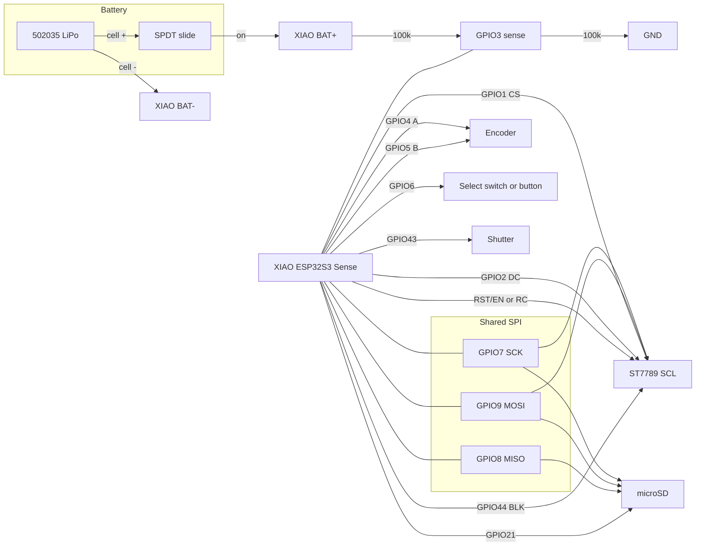

# Somnium on Seeed XIAO ESP32S3 Sense

Kickstarter camera: a XIAO ESP32S3 Sense, a 1.14" ST7789, one shutter, one
rotary encoder, and a protected 502035 LiPo. The slide switch is in series
with the battery positive lead. It is not a GPIO. With the switch off the
cell is disconnected, so USB can still run the board but **cannot charge
the battery**.

The firmware on this branch does not join a home Wi-Fi network. A phone
pairs over BLE, then joins a short-lived SoftAP to move full-size JPEGs.
The phone relays those files to the owner's API, which runs on a machine
on the same LAN as the phone, not in the cloud. The wire format the phone
uses toward that API is unchanged (`POST /v1/process`). The camera/phone
framing is [`PROTOCOL.md`](PROTOCOL.md).

## Pin map

Header names are the silkscreen on the XIAO (`D0`…`D10`). GPIO numbers are
what the firmware uses.

| Function | Header | GPIO | Direction | Notes |
| --- | --- | --- | --- | --- |
| Display CS | D0 | 1 | out | Required. The panel must have a CS pin. |
| Display DC | D1 | 2 | out | Data / command. |
| Battery sense | D2 | 3 | analog in | ADC1. 100 kΩ / 100 kΩ from BAT+ to GND, midpoint here, 100 nF to GND. |
| Encoder A | D3 | 4 | in, pull-up | Wake source. Idle high at a detent. |
| Encoder B | D4 | 5 | in, pull-up | Wake source. Idle high at a detent. |
| Select | D5 | 6 | in, pull-up | Encoder push **or** a separate button. Active low. Wake source. |
| Shutter | D6 | 43 | in, pull-up | Active low. Wake source. |
| Display BLK | D7 | 44 | out | Active high. Off in light sleep. |
| SPI SCK | D8 | 7 | out | Shared by the display SCL and the microSD. |
| SPI MISO | D9 | 8 | in | microSD only. The display does not read it. |
| SPI MOSI | D10 | 9 | out | Display SDA and microSD MOSI. |
| microSD CS | onboard | 21 | out | Wired on the Sense expansion, not on the header. Also the XIAO user-LED net, so the LED flickers during card access. Do not drive it for anything else. |

Camera FPC (fixed on the Sense board, not free to move): XCLK 10, SCCB SDA 40,
SCCB SCL 39, D0–D7 = 15, 17, 18, 16, 14, 12, 11, 48, VSYNC 38, HREF 47,
PCLK 13, PWDN and RESET not connected.

Nothing in that camera set overlaps the table above.

### Battery divider

D2/GPIO3 is free because the panel reset is not a GPIO (see below). It is
ADC1 channel 2, so Wi-Fi can stay up without stealing the converter. The
sense net is the XIAO **BAT+** pad, which is the cell only when the slide
switch is on.

```
BAT+ ---- 100k ----+---- 100k ---- GND
                   |
                  100nF
                   |
                  GND
                   |
                 D2 / GPIO3
```

The firmware averages eight `analogReadMilliVolts` samples, multiplies by
2, and smooths with a 3/4 exponential average. Percent is a straight line
from 3.3 V = 0% to 4.2 V = 100%. It does not sample during a capture, an
SD write, or while the SoftAP is up. The screen shows an icon and the
percent; at or below 10% the number is replaced by `LOW`.

Two resistors of 100 kΩ from 4.2 V draw about **20 µA** (4.2 V / 200 kΩ)
whenever the slide switch is on, including light sleep. That is the cost
of leaving the divider connected. Sleep does not switch the divider off.

GPIO3 is also an ESP32-S3 strapping pin (it selects the JTAG source). The
divider holds it near half the pack voltage while the chip comes out of
reset, which is not a solid high or low. Confirm on the bench that USB
still enumerates with the divider fitted. If it does not, the boot is
hitting that strap; do not "fix" it by driving GPIO3 as a reset output
again.

`chg` stays unknown. There is still no VBUS-sense GPIO. The orange LED by
the USB socket is the charger IC. While USB is charging, BAT+ sits at the
charger voltage, so the percent reads high until the cell is actually
near full.

### Display

Target module: **1.14" ST7789 IPS, 135×240, 8-pin**, for example Amazon
**B07ZQ1C712**. Pin order on that class of module: GND, VCC, SCL, SDA, RES,
DC, CS, BLK.

The controller window is 135×240. Firmware calls `init(135, 240)` and
`setRotation(1)`, so the UI coordinate space is **240×135 landscape**.
Colors are inverted (`invertDisplay(true)`), which matches the common
1.14" panels. Both are bench checks; `kDisplayRotation` and
`kDisplayInvert` in `lib/Somnium/Config.h` flip them.

**The module must bring out CS.** Many 1.3" 240×240 ST7789 / GC9A01 boards
tie CS to ground and cannot share SPI with the Sense microSD, because the
card and the panel would both hear every byte. Do not substitute one of
those unless it has a real CS pin that can be wired to D0.

BLK is wired to D7 so light sleep can turn the backlight off. These modules
are active-high: high = lit. `kDisplayBlActiveHigh` flips that if a panel
is backwards.

The display RES pin is not connected to a GPIO. `kDisplayRst` is `-1`, and
init sends the ST7789 software reset (`SWRESET`, 0x01) instead of toggling
a pin. Wire RES one of these ways:

1. Straight to the XIAO **RST / EN** pad, so the panel resets whenever the
   chip resets.
2. A 10 kΩ pull-up from RES to 3V3, and 100 nF from RES to GND, if you
   would rather not share the button reset. The RC holds the panel in
   reset for a few milliseconds at power-up.

D6 and D7 are UART0 TX/RX on the bare chip. This firmware boots USB CDC
(`ARDUINO_USB_CDC_ON_BOOT`) so the log stays on the USB-C jack and those
pins stay the shutter and the backlight.

### Select: two wiring options, one GPIO

Logical select is GPIO6, input pull-up, active low. The firmware does not
care which part closes it to ground.

1. **Encoder with a push switch.** Bourns PEC11R-4215F-S0024 (or any
   detent encoder whose switch is a separate pair). Switch common to GPIO6,
   the other side to GND. A and B to GPIO4 and GPIO5.
2. **Encoder without a switch, plus a tactile button.** Bourns
   PEC11R-4015F-N0024 (the `N` means no switch) or any plain quadrature
   wheel. A separate button (6×6 tactile, or a larger shutter-style
   button) between GPIO6 and GND.

Leaving GPIO6 **unconnected** is also valid. The internal pull-up holds it
high, so it does not false-wake and it does not look like a held button.
The UI still works: turn the encoder to change mode, tap the shutter to
shoot, **hold the shutter for 550 ms** (`kSelectHoldMs`) for select
(open storage, leave review, leave an error, accept pairing). Review also
returns to the mode carousel on its own after a few seconds.

Light sleep wakes on any of these going low:

- shutter (GPIO43)
- encoder A (GPIO4)
- encoder B (GPIO5)
- select (GPIO6), if a switch is fitted

A rotation wakes the chip because a detent pulls A or B low. The gray code
that happened while the CPU was stopped is discarded so it does not jump
the carousel; the next detent after wake does.

### Power and charging

```
protected cell + ---- slide (SPDT, one throw) ---- XIAO BAT+
protected cell - --------------------------------- XIAO BAT-
USB-C on the XIAO: runs the board, and feeds the onboard charger
```

Use the charger's BAT pads, not a random GPIO. The charger (on the XIAO,
not in this firmware) connects USB VBUS to the cell only through those
pads. The slide switch is on the cell side of BAT+.

| Switch | USB | What happens |
| --- | --- | --- |
| On | No | Board runs from the cell. |
| On | Yes | Board runs from USB. Cell charges. Charge LED follows the charger IC. |
| Off | Yes | Board runs from USB. Cell is open, so it does **not** charge. |
| Off | No | True off. No firmware, no charge. |

Light sleep does not change any of that. It stops the CPU, the backlight,
the camera, BLE, and the SoftAP. It does not reconfigure USB, the BAT
pads, or the charger. The charge LED keeps doing whatever the charger IC
is doing. The battery divider stays connected and draws about 20 µA.

Idle time before sleep is `Defaults::kInactivitySleepMs` (45 s). A capture,
an SD save, or a phone transfer holds a busy flag so sleep waits until
that finishes. Releasing the busy flag starts the 45 s again.

## Wiring diagram



```
                    3V3 ------------------+-- TFT VCC
                                          |
GND -- TFT GND                            |
GND -- encoder common                     |
GND -- shutter                            |
GND -- select                             |
                                          |
GPIO1  D0  CS  ---------------- TFT CS    |
GPIO2  D1  DC  ---------------- TFT DC    |
TFT RES -------- XIAO RST/EN    (or 10k to 3V3 and 100nF to GND)
BAT+ -- 100k --+-- 100k -- GND
               +-- 100nF -- GND
               +-- GPIO3 D2
GPIO44 D7  BLK ---------------- TFT BLK   |
GPIO7  D8  SCK ----- TFT SCL and SD SCK   |
GPIO9  D10 MOSI ---- TFT SDA and SD MOSI  |
GPIO8  D9  MISO ---- SD MISO              |
GPIO21     CS   ---- SD CS (on the Sense) |
                                          |
GPIO4  D3  ---------------- encoder A     |
GPIO5  D4  ---------------- encoder B     |
GPIO6  D5  ---------------- select        |
GPIO43 D6  ---------------- shutter       |
                                          |
BAT+ ----- slide ----- cell +             |
BAT- ---------------- cell -              |
```

## Antenna

The Sense board ships with a ceramic antenna selected by a 0 Ω jumper.
The kickstarter build uses the U.FL connector (Wi-Fi and BLE share it).
Move that jumper from the ceramic-antenna pads to the U.FL pads before
the external antenna is attached. Seeed's XIAO ESP32S3 Sense wiki has the
placement photo; confirm it on the board in hand rather than from memory
of the silk. Do not power the radio with the jumper removed and no
antenna fitted.

## BOM

| Qty | Part | Example number | Notes |
| --- | --- | --- | --- |
| 1 | Seeed XIAO ESP32S3 Sense | Seeed 102010610 | OV5640 autofocus, microSD, 8 MB flash, 8 MB PSRAM. Confirm the SKU on the Seeed page before ordering. |
| 1 | 2.4 GHz U.FL antenna | A short whip or FPC with a U.FL plug | After the antenna jumper is moved. |
| 1 | Protected LiPo 3.7 V, ~400 mAh, 502035 | A 502035 cell with a protection PCB | Bare leads soldered to the BAT pads through the switch. Protect the pack from a hard short while soldering. |
| 1 | SPDT slide switch | C&K OS102011MS2QN1, or an SS12D00-style SPDT slide | Wire common and one throw. The third pin is unused. |
| 1 | 1.14" ST7789 135×240 SPI, 8-pin, with CS | Amazon B07ZQ1C712 | GND, VCC, SCL, SDA, RES, DC, CS, BLK. |
| 1 | Quadrature encoder **with** switch | Bourns PEC11R-4215F-S0024 | Option A. 24 detents is a reasonable feel. |
| 1 | Quadrature encoder **without** switch | Bourns PEC11R-4015F-N0024 | Option B. Buy this instead of the row above, not as well. |
| 1 | Tactile button for select | 6×6 mm tactile, or Omron B3F-1000 | Option B only. Same net as the encoder switch would have used (GPIO6 to GND). |
| 1 | Shutter button | 6×6 mm tactile, or a larger 12 mm button | GPIO43 to GND. |
| 2 | 100 kΩ resistor, 1% | Any 100 kΩ 1% | Battery divider, BAT+ to GPIO3 to GND. |
| 1 | 100 nF capacitor | 100 nF ceramic, 16 V or higher | GPIO3 to GND, across the bottom divider resistor. |
| 1 | 100 nF capacitor | 100 nF ceramic, 16 V or higher | Only if TFT RES uses the RC instead of XIAO RST/EN. |
| 1 | 10 kΩ resistor | Any 1% or 5% | TFT RES pull-up to 3V3, only for that RC reset. |

## Assembly

1. Move the antenna 0 Ω jumper to the U.FL pads and attach the antenna.
2. Confirm the display module has a CS pin. Wire it as in the table. SCL
   and SDA share the SD socket's SCK and MOSI. Do not also wire a second
   SPI bus.
3. Solder encoder A/B, the shutter, and either the encoder switch or the
   standalone select button. All switches are to ground. Wire the battery
   divider to BAT+ and D2, and wire TFT RES to RST/EN or the RC.
4. Solder the cell negative to BAT−. Solder the cell positive to one side
   of the slide, and the other side of the slide to BAT+. Double-check
   polarity before the switch is turned on.
5. Flash `pio run -t upload -e xiao_esp32s3_sense` with the USB-C cable.
   The log is USB CDC at any baud the monitor opens (the sketch asks for
   115200).
6. With the switch on and no USB, the board should boot, paint the color
   bars, and advertise BLE name `Somnium`.

## What has to be tested on the bench

No board was attached while this firmware was written. Compile is not a
substitute for the list below.

- Boot with the divider and the display attached. GPIO3 is a strap pin
  held near half the pack voltage; USB must still enumerate.
- Battery reading versus a meter on BAT+. Icon and percent on the mode
  header, `LOW` at or below 10%, and BLE Battery Level (`0x180F` /
  `0x2A19`) matches that percent. No fresh samples during a capture or
  while the SoftAP is up.
- Color bars and UI orientation. If the image is mirrored or upside down,
  change `kDisplayRotation`. If colors are negative, flip `kDisplayInvert`.
- Backlight: lit while awake, dark in light sleep, lit again after wake.
  If the panel is dark whenever the GPIO is high, flip
  `kDisplayBlActiveHigh`.
- Shared SPI: shoot, save, browse storage, and pull a file while the UI
  is drawing. The card must not corrupt and the panel must not tear into
  SD traffic. CS on both devices has to idle high.
- Camera: log line `pid=0x5640` (OV5640). Autofocus firmware load
  (`CAM AF on`) at boot and again on the first shutter after a wake.
  Confirm the picture is upright; `kCameraMirrorHorizontal` flips it.
- Shutter tap takes a photo. Shutter held about half a second opens
  storage or leaves review, and does not also take a photo.
- With a select button fitted, a click does the same as that hold.
- With select **not** fitted, the mode carousel, shutter, review timeout,
  and hold-to-open-storage path still work, and the board does not wake
  by itself.
- Encoder turn changes mode while awake, and wakes the board from light
  sleep. The waking flick may only wake; the next detent changes mode.
- Sleep begins 45 s after the last shutter, turn, or select
  (`kInactivitySleepMs`). It does not start during a capture, an SD
  write, or a SoftAP transfer.
- After wake: the same screen comes back, the shutter works, and the
  camera streams again. Time the wake. AF reload is allowed to happen on
  the following shutter, not before the backlight is on.
- Sleep current, with the backlight confirmed off, USB unplugged, switch
  on. Record the number. Expect the camera and the radio to dominate if
  either failed to stop.
- Charging: switch on, USB in, charge LED behaves, cell voltage rises.
  Switch off, USB in, board still runs, cell voltage does **not** rise.
  Repeat the charge test while the firmware is in light sleep (switch on).
- BLE: phone sees `Somnium`, connect shows the pair hint, hold or click
  accepts, commands before that are ignored. Status reads `batt=?`.
- Preview notifies arrive as 19-byte packets. A missing sequence is
  allowed; the full file is the HTTP object.
- SoftAP `Somnium-XXXX`, password from the session characteristic. Phone
  joins, `GET` with `Range` resumes, `PUT` of the edited JPEG lands in
  review. Pull the cable mid-download and resume.
- No phone: the original is on the card and the screen shows it as saved.
  A later BLE session can `PULL` that id.
- Queue still lists the shot after a reboot.
